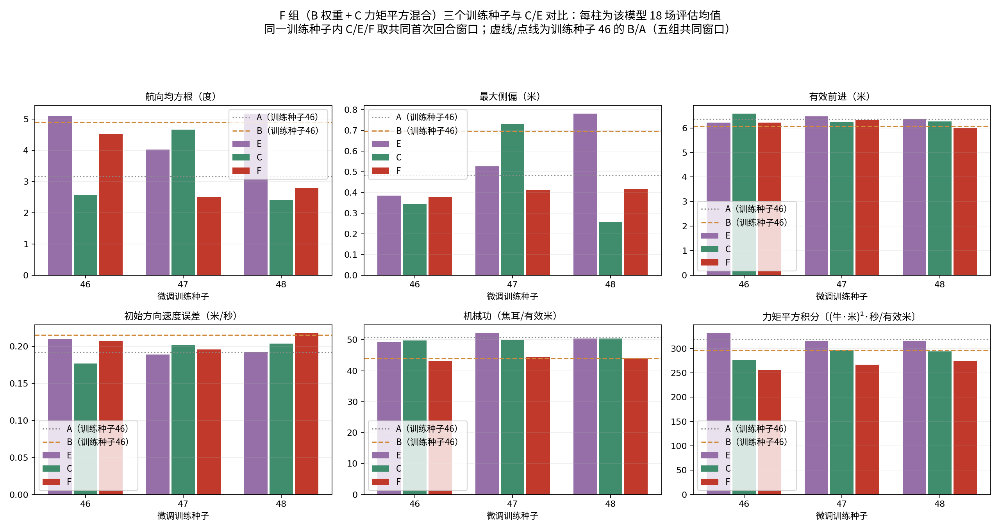

# F 组（B+C 组合）多训练种子比较结果

F 组能耗项：r_F = -0.012 × (0.9 × Σ|τ·q̇| + 0.1 × s × Στ²)，s = 0.17440421040278947。从同一个 30000 次预训练模型微调 5000 次，训练种子 46/47/48，各 18 场正式评估（6 场景 × 3 评估种子）。
训练与评估使用冻结实现（相对 C/E 复验冻结实现只加了分支 F）。所有模型在同一评估种子×场景下的地形、电机、环境配置、动力学和首步观测逐项核验一致。

## 0. 结论（人工解读，脚本重跑不会生成本节）

1. **能耗：F 稳定地达到了 B 的水平。** 三个训练种子的每米有效前进机械功是 43.2、44.5、44.0 焦耳，都在 B 的 1.05 倍（46.13）以内。和同训练种子的 C、E 比，机械功低 12%–13%，力矩平方积分低 8%（相对 C）和 17%（相对 E），三个种子方向全部一致。在训练种子 46 上，F 的机械功和 B 持平（-1.7%，区间跨 0），力矩平方积分比 B 低 13.7%。
2. **楼梯方向保持：大部分修好了，但不是每个种子都修好。** B 在楼梯上的航向均方根是 16.8 度、最大侧偏 1.95 米，F 在训练种子 46、47 上降到 3.1 度和 1.7 度，比 A、C 还低；两种对角支撑相的偏航在种子 46 上恢复了正负抵消。训练种子 48 的楼梯航向均方根是 6.43 度，刚好超过 6.4 的门槛，有一次末帧侧偏 1.07 米，三次评估的末帧航向都往正方向偏（+19、+8、+4 度），和 B 的单向扭转是同一种现象，只是轻得多。
3. **原任务通过率没达标。** 通过数是 16、16、17（门槛 17/18）。5 次失败都没有摔倒，前进距离也够，全部是末帧侧偏刚超过 1 米（1.00–1.50 米）：训练种子 46 在平地 1.0 失败 2 次（航向均方根 8.6、12.0 度），训练种子 47、48 在崎岖 1.0 失败 3 次。也就是说，F 把楼梯的偏航压住了，但在高速平地和崎岖地形上方向保持仍不如 C。
4. **代价是速度跟踪稍差。** 跨三个种子，初始方向速度误差比 C 高 6.6%，有效前进少 3%。
5. **总体判断：** 按事先定的三条达标线，F 没有一个训练种子全部达标，所以不能说"同时保住了 B 的低机械功和 C 的方向保持"。比较准确的说法是：F 在不损失 B 的节能的前提下，把 B 最严重的问题（楼梯单向扭转）在 2/3 个种子上消除，整体航向和 C 持平（+2%），但通过率和速度跟踪比 C 差一点。

## 1. 达标线检查

参考值：B 组（训练种子 46）每米有效前进机械功 43.93 焦耳，1.05 倍为 46.13；A 组楼梯航向均方根 4.27 度。本节用各模型自身完整首次回合。

| 训练种子 | 每米机械功（≤ 46.13） | 楼梯航向均方根（≤ 6.4°） | 楼梯末帧侧偏最大值（≤ 1 米） | 原任务通过（≥ 17/18） | 全部达标 |
|---|---:|---:|---:|---:|---|
| 46 | 43.20 ✅ | 3.05 ✅ | 0.29 ✅ | 16/18 ❌ | 否 |
| 47 | 44.48 ✅ | 1.72 ✅ | 0.21 ✅ | 16/18 ❌ | 否 |
| 48 | 43.96 ✅ | 6.43 ❌ | 1.07 ❌ | 17/18 ✅ | 否 |

## 2. 训练种子 46：A/B/C/E/F 五组比较

五组取共同首次回合窗口。

| 组别 | 原任务通过 | 航向均方根（度） | 最大侧偏（米） | 有效前进（米） | 初始方向速度误差（米/秒） | 机械功（焦耳/有效米） | 力矩平方积分/有效米 |
|---|---:|---:|---:|---:|---:|---:|---:|
| A | 17/18 | 3.1578 | 0.4828 | 6.3628 | 0.1919 | 50.7840 | 318.9879 |
| B | 18/18 | 4.9082 | 0.6958 | 6.0728 | 0.2152 | 43.9310 | 296.1652 |
| C | 18/18 | 2.5687 | 0.3444 | 6.5858 | 0.1767 | 49.8157 | 276.7321 |
| E | 16/18 | 5.1044 | 0.3852 | 6.2139 | 0.2092 | 49.3406 | 331.8075 |
| F | 16/18 | 4.5325 | 0.3768 | 6.2121 | 0.2067 | 43.2022 | 255.6323 |

楼梯 8.5 厘米场景（3 次评估均值，五组共同窗口）：

| 组别 | 通过 | 航向均方根（度） | 最大侧偏（米） | 机械功（焦耳/有效米） | 力矩平方积分/有效米 |
|---|---:|---:|---:|---:|---:|
| A | 3/3 | 4.2746 | 0.5936 | 79.9731 | 406.1407 |
| B | 3/3 | 16.7846 | 1.9483 | 72.3161 | 428.7239 |
| C | 3/3 | 4.4810 | 0.6515 | 74.8378 | 358.1907 |
| E | 3/3 | 5.2903 | 0.4330 | 69.8266 | 360.7019 |
| F | 3/3 | 3.0523 | 0.1692 | 64.5448 | 335.2343 |

F 相对各组的配对变化（每对单独取共同窗口；区间按评估种子重采样，仅作描述）：

| 指标 | F 相对 A | F 相对 B | F 相对 C | F 相对 E |
|---|---:|---:|---:|---:|
| 航向均方根（度） | +43.53%* | -7.65% | +76.45%* | -11.20%* |
| 最大侧偏（米） | -21.94% | -45.84%* | +9.43% | -2.16% |
| 有效前进（米） | -2.37%* | +2.29%* | -5.67%* | -0.03% |
| 机体系速度误差（米/秒） | +7.81%* | -1.86%* | +17.17%* | -1.08% |
| 初始方向速度误差（米/秒） | +7.71%* | -3.93%* | +17.00%* | -1.18% |
| 机械功（焦耳/有效米） | -14.93%* | -1.66% | -13.28%* | -12.44%* |
| 力矩平方积分〔(牛·米)²·秒/有效米〕 | -19.86%* | -13.69%* | -7.62%* | -22.96%* |
| 机械功（焦耳/路径米） | -14.91%* | -0.00% | -13.35%* | -11.93%* |
| 力矩平方积分〔(牛·米)²·秒/路径米〕 | -19.83%* | -12.38%* | -7.67%* | -22.59%* |

\* 表示描述性 95% 区间不跨 0。

## 3. 三个训练种子：F 与 C、E 同训练种子比较

每个训练种子内 C/E/F 取共同首次回合窗口。

| 训练种子 | 组别 | 原任务通过 | 航向均方根 | 最大侧偏 | 初始方向速度误差 | 机械功/有效米 | 力矩平方积分/有效米 | 楼梯航向均方根 |
|---|---|---:|---:|---:|---:|---:|---:|---:|
| 46 | E | 16/18 | 5.1044 | 0.3852 | 0.2092 | 49.3406 | 331.8075 | 5.2903 |
| 46 | C | 18/18 | 2.5687 | 0.3444 | 0.1767 | 49.8157 | 276.7321 | 4.4810 |
| 46 | F | 16/18 | 4.5325 | 0.3768 | 0.2067 | 43.2022 | 255.6323 | 3.0523 |
| 47 | E | 17/18 | 4.0285 | 0.5257 | 0.1889 | 52.1892 | 315.8515 | 9.7764 |
| 47 | C | 15/18 | 4.6643 | 0.7309 | 0.2017 | 49.9314 | 296.4617 | 7.5625 |
| 47 | F | 16/18 | 2.5120 | 0.4122 | 0.1954 | 44.4777 | 266.5998 | 1.7152 |
| 48 | E | 14/18 | 5.1800 | 0.7807 | 0.1917 | 50.4737 | 315.3483 | 11.4917 |
| 48 | C | 18/18 | 2.3955 | 0.2577 | 0.2032 | 50.3789 | 293.8214 | 5.3805 |
| 48 | F | 17/18 | 2.7944 | 0.4171 | 0.2176 | 43.9606 | 274.3180 | 6.4270 |

单位：度、米、米/秒、焦耳/有效米、(牛·米)²·秒/有效米、度。

跨三个训练种子（先种子内平均，再种子间平均）：

| 指标 | E 均值 | C 均值 | F 均值 | F 相对 C | F 优于 C 的种子数 | F 相对 E | F 优于 E 的种子数 |
|---|---:|---:|---:|---:|---:|---:|---:|
| 航向均方根（度） | 4.7709 | 3.2095 | 3.2797 | +2.19% | 1/3 | -31.26% | 3/3 |
| 最大侧偏（米） | 0.5638 | 0.4443 | 0.4020 | -9.52% | 1/3 | -28.70% | 3/3 |
| 有效前进（米） | 6.3584 | 6.3662 | 6.1752 | -3.00% | 1/3 | -2.88% | 0/3 |
| 机体系速度误差（米/秒） | 0.1919 | 0.1901 | 0.2034 | +7.02% | 1/3 | +5.96% | 1/3 |
| 初始方向速度误差（米/秒） | 0.1966 | 0.1939 | 0.2066 | +6.57% | 1/3 | +5.08% | 1/3 |
| 机械功（焦耳/有效米） | 50.6678 | 50.0420 | 43.8801 | -12.31% | 3/3 | -13.40% | 3/3 |
| 力矩平方积分〔(牛·米)²·秒/有效米〕 | 321.0024 | 289.0051 | 265.5167 | -8.13% | 3/3 | -17.29% | 3/3 |
| 机械功（焦耳/路径米） | 49.9693 | 49.4908 | 43.5299 | -12.04% | 3/3 | -12.89% | 3/3 |
| 力矩平方积分〔(牛·米)²·秒/路径米〕 | 317.0896 | 285.7920 | 263.4253 | -7.83% | 3/3 | -16.92% | 3/3 |

楼梯场景航向均方根 F 相对 C：-35.75%，F 优于 C 的种子数 2/3，各种子差值 [-1.43, -5.85, 1.05] 度。

## 4. 楼梯爬升段步态分析

口径与 11-05 的 B 组分析相同：机身 x 在 -8.5 到 -11.05 米之间、去掉前 50 步；足端接触力 > 5 牛视为支撑。用各自首次回合。

| 训练种子 | 组别 | FL+RR 支撑偏航（°/s） | FR+RL 支撑偏航（°/s） | 正负抵消 | 过 x=-11 累计航向（°） | 末帧航向（3 次，°） | 机械功率（瓦） | 力矩平方和 | 大腿/小腿功率（瓦） |
|---|---|---:|---:|---|---:|---|---:|---:|---:|
| 46 | A | +2.17 | -2.00 | 是 | +4.8 | [3.0, 4.5, 2.9] | 55.9 | 284 | 19.3/31.2 |
| 46 | B | +4.88 | +3.13 | 否 | +19.6 | [17.2, 32.7, 16.4] | 45.0 | 266 | 14.8/25.7 |
| 46 | C | +0.49 | -0.42 | 是 | +2.7 | [10.2, 7.6, 5.7] | 56.7 | 271 | 20.0/31.3 |
| 46 | E | +2.32 | +2.76 | 否 | +7.2 | [3.3, 2.2, 9.7] | 51.8 | 267 | 17.9/29.1 |
| 46 | F | +2.54 | -1.61 | 是 | +0.7 | [-4.3, -5.1, -7.4] | 46.1 | 239 | 15.5/26.1 |
| 47 | C | +2.10 | +1.28 | 否 | +8.6 | [9.3, 5.4, 12.7] | 52.3 | 249 | 18.9/28.6 |
| 47 | E | +4.13 | -2.22 | 是 | +8.6 | [15.8, 19.4, 17.0] | 58.4 | 283 | 19.7/33.2 |
| 47 | F | -0.48 | -0.80 | 否 | -0.5 | [-0.1, 2.0, 0.9] | 50.9 | 254 | 17.4/29.4 |
| 48 | C | +0.21 | +1.34 | 否 | +3.5 | [12.6, 4.2, -1.1] | 56.1 | 275 | 18.5/32.3 |
| 48 | E | +2.88 | +1.83 | 否 | +7.7 | [24.0, 25.3, 18.2] | 54.9 | 281 | 18.3/31.4 |
| 48 | F | +2.08 | +0.27 | 否 | +6.8 | [19.0, 8.4, 4.4] | 46.7 | 232 | 16.1/26.4 |

## 5. 统计口径与限制

训练种子内对六场景×三个评估种子等权平均，再对训练种子等权平均；区间只按训练种子整组重采样（27 种有放回组合），仅作描述。
三次微调共享同一个预训练检查点，不是三次从零训练；评估只有一套固定地形布局。B 和 A 只有训练种子 46，所以 F 与 B 的比较只能在训练种子 46 上配对，跨种子只能与 C/E 比较。
能耗指标是关节机械功代理，不等于真实电池能耗。

