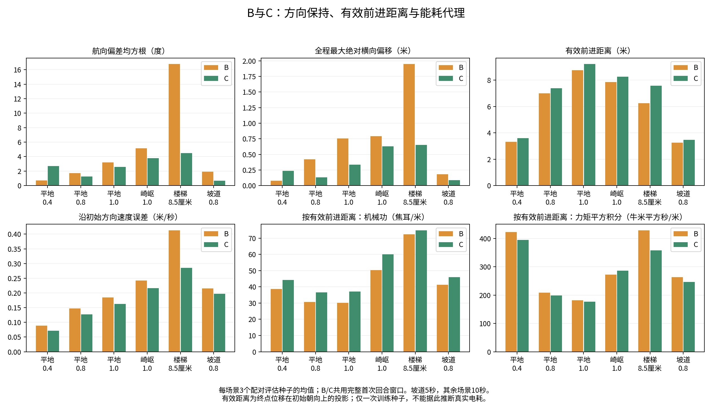

# B与C方向保持及有效前进复评

已对原90场轨迹补充方向指标；B/C主比较为18组配对场景。无需重跑仿真，原始轨迹和既定任务通过判据保持原样。

## 指标与比较口径

- **航向偏差**：每步偏航角减固定初始目标航向，用正弦与余弦的双参数反正切映射至[-180,180]度；报告均方根、最大绝对值和终点绝对值。
- **横向偏移**：(位置-初始位置)在初始朝向水平垂线上的投影；报告均方根、最大绝对值和终点绝对值。
- **有效前进距离**：终点水平位移在初始朝向单位向量上的投影；有符号净进展，侧向运动不增加它，后退抵消前进，不累计正向增量。
- **每米有效前进能耗**：首次回合窗口内总机械功或力矩平方积分除以有效前进距离；非正距离记不可定义并中止自动均值，不能计为零能耗。
- **沿初始方向速度误差**：将机体系三维线速度按偏航、俯仰、横滚姿态旋转至世界系，再投影至初始方向，与固定前向指令计算均方根误差。
- **窗口**：五策略总表保留五组共同首次回合窗口；B/C复评单独使用两组共同首次回合窗口，不能被D的提前终止截短。
- **总体均值**：对18个场景/种子的逐次指标等权平均；单位距离指标是各次比值的均值，不是总能量除以总距离。
- **成功率**：保留原任务通过判据；方向阈值只作事后敏感性分析，不替代原成功率，不是预先注册标准。
- **统计限制**：1个训练种子、3个评估种子、1套地形布局。重采样区间仅描述本批结果，不证明训练可重复性或真实电池节能。

B/C全部首次回合均完整，坡道5秒、其余10秒，每组总计165秒。原五策略共同窗口曾因D在崎岖种子47提前终止而截到9.2秒；本次B/C该场采用10秒，因此与旧均值的微小差别也包含窗口改变，不能全部归因于距离分母变化。

## B/C总体比较

| 指标 | B | C | C相对B变化 |
|---|---:|---:|---:|
| 航向偏差均方根（度） | 4.9082 | 2.5687 | -47.66% |
| 终点绝对航向偏差（度） | 6.9624 | 4.3835 | -37.04% |
| 全程最大绝对横向偏移（米） | 0.6958 | 0.3444 | -50.51% |
| 终点绝对横向偏移（米） | 0.6942 | 0.3438 | -50.48% |
| 有效前进距离（米） | 6.0728 | 6.5858 | +8.45% |
| 有效前进距离／指令距离 | 0.8009 | 0.8660 | +8.12% |
| 有效前进距离／实际路径长度 | 0.9836 | 0.9946 | +1.12% |
| 机身前向速度误差（米/秒） | 0.2075 | 0.1738 | -16.24% |
| 沿初始方向速度误差（米/秒） | 0.2152 | 0.1767 | -17.89% |
| 按实际路径长度：机械功（焦耳/米） | 42.9009 | 49.5105 | +15.41% |
| 按有效前进距离：机械功（焦耳/米） | 43.9310 | 49.8157 | +13.40% |
| 按实际路径长度：力矩平方积分（牛米平方秒/米） | 289.7578 | 274.9874 | -5.10% |
| 按有效前进距离：力矩平方积分（牛米平方秒/米） | 296.1652 | 276.7321 | -6.56% |

距离越大、距离利用比例越高通常越好；误差、偏移和单位距离代价越低越好。由于坡道时长短于其他场景，总体距离只用于同协议B/C比较，具体结论需结合分场景数据。

## 分场景方向与进展

| 场景 | 航向均方根 B/C（度） | 最大侧偏 B/C（米） | 有效前进 B/C（米） |
|---|---:|---:|---:|
| 平地0.4 | 0.706 / 2.682 | 0.076 / 0.237 | 3.317 / 3.601 |
| 平地0.8 | 1.725 / 1.236 | 0.419 / 0.129 | 6.996 / 7.391 |
| 平地1.0 | 3.182 / 2.572 | 0.756 / 0.333 | 8.753 / 9.222 |
| 崎岖1.0 | 5.138 / 3.767 | 0.793 / 0.629 | 7.861 / 8.262 |
| 楼梯8.5厘米 | 16.785 / 4.481 | 1.948 / 0.652 | 6.247 / 7.577 |
| 坡道0.8 | 1.913 / 0.674 | 0.183 / 0.086 | 3.263 / 3.462 |

## 按有效前进距离计算的能耗代理

| 场景 | 机械功 B/C（焦耳/有效米） | C相对B | 力矩平方积分 B/C（牛米平方秒/有效米） | C相对B |
|---|---:|---:|---:|---:|
| 平地0.4 | 38.724 / 44.231 | +14.22% | 422.262 / 394.604 | -6.55% |
| 平地0.8 | 30.616 / 36.570 | +19.45% | 209.044 / 198.663 | -4.97% |
| 平地1.0 | 30.202 / 37.176 | +23.09% | 181.337 / 176.445 | -2.70% |
| 崎岖1.0 | 50.380 / 60.113 | +19.32% | 272.568 / 285.976 | +4.92% |
| 楼梯8.5厘米 | 72.316 / 74.838 | +3.49% | 428.724 / 358.191 | -16.45% |
| 坡道0.8 | 41.347 / 45.967 | +11.17% | 263.056 / 246.513 | -6.29% |

## 事后方向阈值敏感性

以下为“原任务通过、全程无提前终止，并同时满足最大航向与侧偏限制”的场次数。阈值是在发现偏转后加入，用于透明展示敏感性，不将某一阈值包装为预先规定的成功率。

| 最大航向偏差上限（度） | 最大侧偏上限（米） | B | C |
|---|---:|---:|---:|
| 10 | 0.5 | 9/18 | 13/18 |
| 10 | 1 | 15/18 | 16/18 |
| 10 | 2 | 15/18 | 16/18 |
| 20 | 0.5 | 9/18 | 13/18 |
| 20 | 1 | 15/18 | 18/18 |
| 20 | 2 | 15/18 | 18/18 |
| 30 | 0.5 | 9/18 | 13/18 |
| 30 | 1 | 15/18 | 18/18 |
| 30 | 2 | 17/18 | 18/18 |

## 数据驱动的结论

- 航向偏差均方根（度）：C相对B变化 -47.66%；逐种子配对差值的描述性95%区间为 [-2.7898, -1.6324]。
- 全程最大绝对横向偏移（米）：C相对B变化 -50.51%；逐种子配对差值的描述性95%区间为 [-0.3919, -0.3278]。
- 有效前进距离（米）：C相对B变化 +8.45%；逐种子配对差值的描述性95%区间为 [0.4121, 0.6422]。
- 沿初始方向速度误差（米/秒）：C相对B变化 -17.89%；逐种子配对差值的描述性95%区间为 [-0.0496, -0.0319]。
- 按有效前进距离：机械功（焦耳/米）：C相对B变化 +13.40%；逐种子配对差值的描述性95%区间为 [4.1811, 7.1709]。
- 按有效前进距离：力矩平方积分（牛米平方秒/米）：C相对B变化 -6.56%；逐种子配对差值的描述性95%区间为 [-31.6428, -4.7246]。

改用有效前进距离后，C仍以更高的机械功换取更低的力矩平方积分。B的机械能优势并未仅因改用新距离定义而消失，但方向保持代价必须同时报告；不能再把原任务通过次数相同解释为运动性能相同。

下一步建议：根据实际路线要求预先确定航向/侧偏容许范围，在更多独立训练种子上验证B/C，并补对应的纯机械功率低权重对照。当前方向指标补充与B/C离线复评已完成。

